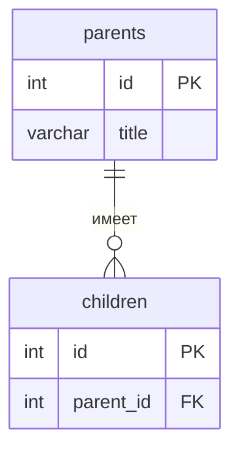

<!--
  Это шаблон README проекта. После создания своего репозитория:
  1. Переименовать репозиторий в backend-<фамилия>-<тема>, например backend-ivanova-library.
  2. Заполнить разделы ниже под свою тему и удалить этот комментарий.
  Задания лаб лежат в папке docs/, начинать с docs/README.md.
-->

# backend-restaurants

Тема №5: **Отзывы о ресторанах**. Каталог ресторанов с оценками посетителей — для тех, кто выбирает, куда пойти поесть, и для владельцев заведений, которым важна обратная связь.

| | |
| --- | --- |
| Главная сущность | Ресторан (id, title, address, cuisine) |
| Связанная сущность (1:N) | Отзыв (лаба 2) |
| Фишка | ★ валидация + фильтр/пагинация, ★★ Swagger + логи запросов |
| Стек | Python 3.11, FastAPI, Uvicorn, хранение в памяти |

## Как запустить

```bash
git clone <url-репозитория>
cd backend-restaurants
python -m venv .venv
source .venv/bin/activate    #Windows: .venv\Scripts\activate
pip install -r requirements.txt
uvicorn main:app --port 8000 --reload
```

Сервис работает на `http://localhost:8000`.

## Эндпоинты

| Метод | Путь | Что делает | Ответ |
| --- | --- | --- | --- |
| GET | `/health` | Проверка, что сервис жив | 200 `{"status":"ok"}` |
| POST | `/api/restaurants` | Создать | 201 и объект с `id`; 400 при ошибке |
| GET | `/api/restaurants` | Список | 200 |
| GET | `/api/restaurants/{id}` | Получить одну запись | 200; 404 |
| PATCH | `/api/restaurants/{id}` | Изменить | 200; 400; 404 |
| PUT | `/api/restaurants/{id}` | Заменить | 200; 400; 404 |
| DELETE | `/api/restaurants/{id}` | Удалить | 204; 404 |

## ER-диаграмма

<!-- С лабы 2. Блок mermaid GitHub рисует сам. -->



## Интерфейс

<!-- С лабы 4: скриншот, например  -->
