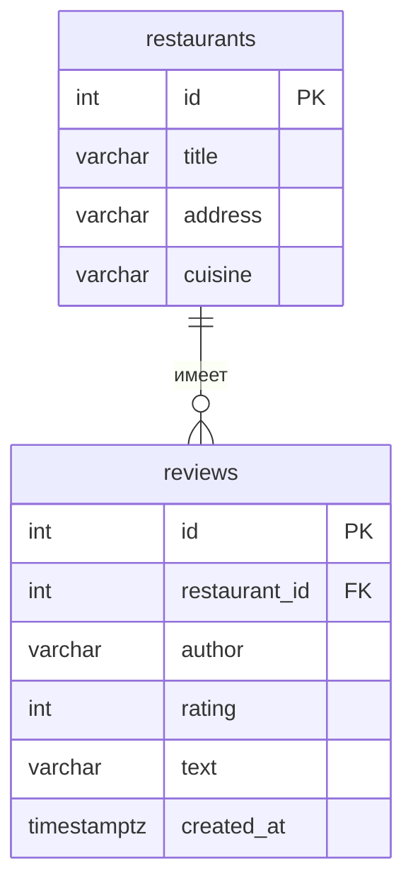

<!--
  Это шаблон README проекта. После создания своего репозитория:
  1. Переименовать репозиторий в backend-<фамилия>-<тема>, например backend-ivanova-library.
  2. Заполнить разделы ниже под свою тему и удалить этот комментарий.
  Задания лаб лежат в папке docs/, начинать с docs/README.md.
-->

# backend-restaurants

Тема №5: **Отзывы о ресторанах**. Каталог ресторанов с оценками посетителей — для тех, кто выбирает, куда пойти поесть, и для владельцев заведений, которым важна обратная связь.

| | |
| --- | --- |
| Главная сущность | Ресторан (id, title, address, cuisine) |
| Связанная сущность (1:N) | Отзыв (лаба 2) |
| Фишка | ★ валидация + фильтр/пагинация, ★★ Swagger + логи запросов |
| Стек | Python 3.11, FastAPI, Uvicorn, хранение в памяти |

## Как запустить

```bash
git clone <url-репозитория>
cd backend-restaurants
python -m venv .venv
source .venv/bin/activate    #Windows: .venv\Scripts\activate
pip install -r requirements.txt
uvicorn main:app --port 8000 --reload
```

Сервис работает на `http://localhost:8000`. Swagger UI — http://localhost:8000/docs

# 1. база
createdb -U postgres restaurants    # или через psql / pgAdmin

# 2. .env
cp .env.example .env
# отредактировать DATABASE_URL под свой пароль

# 3. схема из репозитория
alembic upgrade head

# 4. (опционально) тестовые данные
python seeds.py

# 5. сервер
uvicorn main:app --port 8000 --reload

## Эндпоинты

| Метод | Путь | Что делает | Ответ |
| --- | --- | --- | --- |
| GET | `/health` | Проверка, что сервис жив | 200 `{"status":"ok"}` |
| POST | `/api/restaurants` | Создать | 201 и объект с `id`; 400 при ошибке |
| GET | `/api/restaurants` | Список | 200 |
| GET | `/api/restaurants/{id}` | Получить одну запись | 200; 404 |
| PATCH | `/api/restaurants/{id}` | Изменить | 200; 400; 404 |
| PUT | `/api/restaurants/{id}` | Заменить | 200; 400; 404 |
| DELETE | `/api/restaurants/{id}` | Удалить | 204; 404 |

## ER-диаграмма

<!-- С лабы 2. Блок mermaid GitHub рисует сам. -->


## Валидация и правила

- `title`, `address`, `cuisine` — обязательные непустые строки.
- `author`, `text` — обязательные непустые строки; `rating` — целое 1..5.
- Ошибки валидации: `400` и `{"error": "...", "field": "..."}`.
- **Правило темы:** один автор оставляет только один отзыв на ресторан.
  При нарушении — `409` и объяснение. Гарантируется `UNIQUE (restaurant_id, author)` в БД; проверка и запись — в одной транзакции.

  ## Миграции и сиды

```bash
alembic revision --autogenerate -m "описание"   # новая миграция
alembic upgrade head                            # применить
alembic downgrade -1                            # откатить
python seeds.py                                 # тестовые данные (идемпотентно)
```

Схема создаётся только из репозитория (`alembic upgrade head`), руками в `psql` ничего не создаётся.

## Индекс и EXPLAIN

Функциональный индекс на `lower(title)` с `text_pattern_ops`, создан миграцией Alembic:

```python
Index(
    "ix_restaurants_title_lower",
    func.lower(Restaurant.title),
    postgresql_ops={"lower": "text_pattern_ops"},
)
```

Поиск префиксный: `GET /api/restaurants?q=restoran 99` → `WHERE lower(title) LIKE 'restoran 99%'`.

Запрос:

```sql
EXPLAIN ANALYZE SELECT * FROM restaurants WHERE lower(title) LIKE 'restoran 99%';
```

Вывод:

```
Bitmap Heap Scan on restaurants  (cost=4.63..26.60 rows=18 width=47) (actual time=0.041..0.076 rows=22 loops=1)
  Filter: (lower((title)::text) ~~ 'restoran 99%'::text)
  Heap Blocks: exact=4
  ->  Bitmap Index Scan on ix_restaurants_title_lower  (cost=0.00..4.63 rows=35 width=0) (actual time=0.027..0.027 rows=22 loops=1)
        Index Cond: ((lower((title)::text) ~>=~ 'restoran 99'::text) AND (lower((title)::text) ~<~ 'restoran 9:'::text))
Planning Time: 2.376 ms
Execution Time: 0.161 ms
```

База использует индекс `ix_restaurants_title_lower` (`Bitmap Index Scan` вместо `Seq Scan`).

## Правило 409

Один автор оставляет только один отзыв на ресторан. Проверка реализована ограничением БД:

```sql
UNIQUE (restaurant_id, author)
```

при попытке вставить дубль SQLAlchemy получает `IntegrityError`, транзакция откатывается, сервер возвращает:

```http
HTTP/1.1 409 Conflict
{"error": "этот автор уже оставлял отзыв на этот ресторан", "field": "author"}
```

Проверка и запись выполняются в одной транзакции (`flush` + `commit` в одном блоке с `try/except IntegrityError`).

## Статистика

`GET /api/restaurants/stats` — один агрегатный SQL, считает база:

```sql
SELECT restaurants.id, restaurants.title,
       COUNT(reviews.id) AS reviews_count,
       AVG(reviews.rating) AS avg_rating
FROM restaurants
LEFT JOIN reviews ON reviews.restaurant_id = restaurants.id
GROUP BY restaurants.id, restaurants.title
ORDER BY restaurants.id;
```

Пример ответа:

```json
[
  {"restaurant_id": 1, "title": "Пушкин", "reviews_count": 2, "avg_rating": 4.5},
  {"restaurant_id": 2, "title": "Марио",  "reviews_count": 1, "avg_rating": 5.0}
]
```


## Интерфейс

<!-- С лабы 4: скриншот, например  -->
